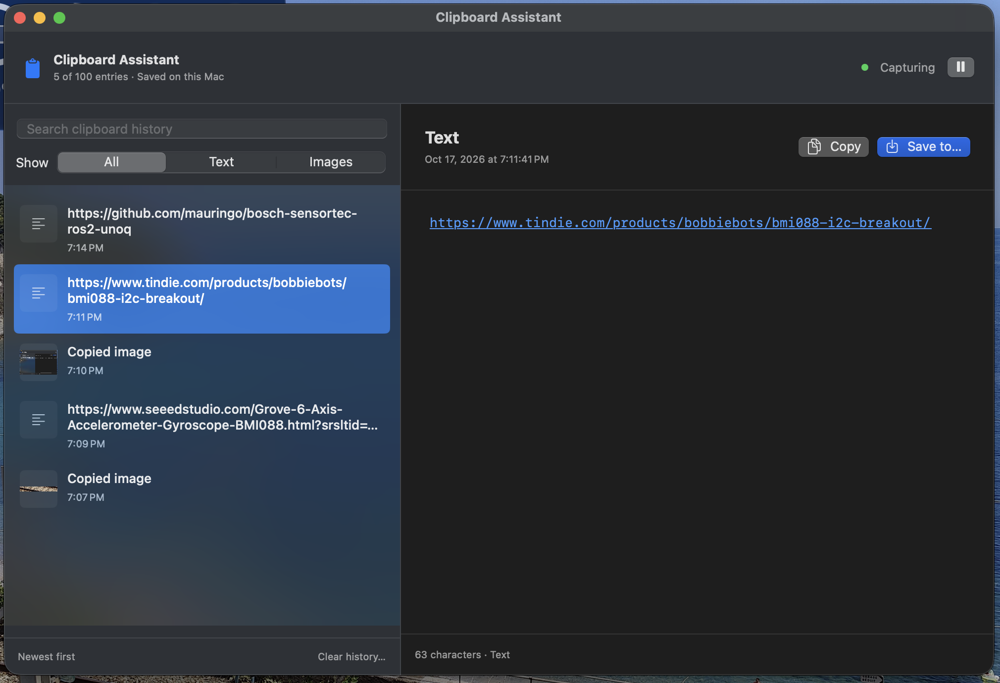

<div align="center">

# 📋 Clipboard Assistant

**A little memory for your Mac’s clipboard.**

Keep the things you copy. Find them again. Save what matters.

**macOS 13+ · Native Swift app · Local storage · Text & images**

</div>



Clipboard Assistant remembers your copied texts and images, ready to search, preview, copy again, or save to a file. Keep **100 entries by default**, choose a limit from **1 to 1,000**, and decide whether history survives a restart. It lives in your macOS menu bar and keeps working when you close its window.

## Small app. Useful everyday details.

| Feature | What you get |
| --- | --- |
| 📋 Clipboard history | Text and image entries, newest first, with a configurable limit of 1–1,000 (default: 100). |
| 🔎 Search & filters | Search copied text or switch between text and images. |
| 🖼️ Image previews | Preview copied images before saving them as PNG files. |
| ↩️ Readable text | Wrapped text and clickable links, including long URLs. |
| 🧩 JSON & YAML | Automatically formatted previews with an **Original** switch for the exact source. |
| 💾 Save to a file | Export text as UTF-8 `.txt` and images as `.png`, using the native macOS save dialog. |
| ⏸️ Capture controls | Pause and resume from the window or the Clipboard Assistant application menu. |
| ⚙️ History settings | Keep history across restarts or use memory-only capture; clean all entries with one button. |
| 🏠 Stays on your Mac | Local clipboard storage; GitHub is contacted for update checks. |

**Your source stays intact.** JSON and YAML formatting only changes the preview. **Copy** and **Save to…** always use the original clipboard text, including whitespace and comments.

## Get started

### Install without Terminal

Download the app archive from [GitHub Releases](https://github.com/mauringo/clipkeep-macos/releases/latest), unzip it, and move **Clipboard Assistant.app** into Applications. The v1.3.0 binary archive supports Apple Silicon Macs. Intel users can build from source. Current builds use an ad hoc signature, without Apple notarization; macOS may block downloaded builds. See [distribution notes](docs/DISTRIBUTION.md).


Double-click **Install Clipboard Assistant.app** in `dist`. It contains the complete app, installs it in **~/Applications**, and opens it. No administrator password or developer tools are required to install or run the built app. Updates quit the running copy before replacing it; history follows your existing retention settings.

You can move the installer on its own, or copy **Clipboard Assistant.app** directly into Applications. Open the `.app` bundle in Finder, rather than the executable inside it, to launch without Terminal.

### Build from source

You’ll need **macOS 13 or later**, **Swift 6 or later**, and the **Apple Command Line Tools**. The first build needs internet access to download the YAML dependency.

From the project folder:

```sh
zsh scripts/build-app.sh
open "dist/Clipboard Assistant.app"
```

The build also creates the self-contained Finder installer. The app opens its history window and adds a **clipboard icon to your menu bar**. You can drag `dist/Clipboard Assistant.app` into **Applications** to keep it handy.

Already built the app? Just double-click **Clipboard Assistant.app** inside `dist`.

For scripted installation, run `zsh scripts/install-app.sh`. This installs the existing build and opens it; it does not rebuild or download dependencies.

### Make yourself at home

1. **Copy something.** Text and clipboard images appear automatically while capture is active.
2. **Find it again.** Search your history or filter by **Text** and **Images**.
3. **Select an entry.** Read wrapped text, open a link, inspect formatted JSON/YAML, or preview an image.
4. **Use it.** Choose **Copy** to put it back on the clipboard, or **Save to…** to export a file.

Drag a history row or the **Drag** handle above its preview into another app. Images can also be dragged directly from the preview. Text is offered as the original plain text and a `.txt` file; images are offered as PNG data and a `.png` file. The receiving app chooses what it accepts. For part of a text entry, select text in the preview and drag the selection using macOS’s usual text behavior.

Right-click any entry for copy, save, and delete actions. Use **Clean history…** to remove all entries.

Closing the window leaves capture running. Click the menu bar clipboard icon to open history directly. Pause capture from the window or the **Clipboard Assistant** application menu; use that menu or **⌘Q** to quit.

## Updates

The app checks GitHub’s latest stable release on launch and every day while running. Use **Clipboard Assistant → Check for Updates…** to check immediately. Turn off **Automatically Check for Updates** in the same menu to disable background checks. Checks send version metadata requests to GitHub; clipboard contents are never included.

Choose **Install Update** when a newer release is found. The app clones that release tag from `mauringo/clipkeep-macos`, builds it locally, stages and verifies the new app, quits, replaces itself, and reopens. It needs **Apple Command Line Tools with Swift 6+**, internet access (including the Yams dependency), and an app installed in a writable folder under the name **Clipboard Assistant.app**. Run `xcode-select --install` once if developer tools are missing. This builds release source on your Mac and uses an ad hoc signature. It does not require a separate updater command.

You can continue using the app during the build. A failed download or build leaves the existing app installed. Update logs are in `~/Library/Application Support/ClipboardAssistant/Updates/update.log`. Installing replaces the app bundle; history retention settings still apply, so memory-only history is lost when the app restarts. If you rename or move the running app, wait until updating finishes first.

## History settings

Open **Settings…** from the **Clipboard Assistant** application menu, click the **gear** in the history window, or press **⌘,**.

- **Keep history after restart or reboot:** enabled by default. Turn it off for memory-only history. Applying removes the saved archive immediately while keeping current entries available until you quit. The app then starts a new history each time it opens.
- **Maximum entries:** choose any whole number from **1 to 1,000**. The default is **100**. Reducing the limit immediately removes the oldest entries when you click **Apply settings**.
- **Clean history…:** remove all current entries from the app, including saved history, after confirmation. This button is available in both Settings and the main window.

Settings are remembered across restarts even when clipboard history is kept only in memory. This controls history retention; the app still needs to be opened after logging in.

## Your clipboard, your Mac

When **Keep history after restart or reboot** is enabled, history is stored at:

```text
~/Library/Application Support/ClipboardAssistant/history.json
```

- **Local storage:** clipboard content is never uploaded by the app.
- **Persistent history:** when enabled, text and image data survive restarts, up to your configured limit. With retention off, clipboard entries stay in memory only.
- **Owner-only file permissions:** the archive is restricted to your macOS user, but it is **not encrypted**.
- **Pause when needed:** copied passwords and other sensitive text can be saved like any other text. Pause capture before copying information you don’t want in history.
- **Clear means app history:** clearing history does not erase the system clipboard or files you have already exported.

## A few things to know

- The clipboard is checked every **half second**. Very rapid clipboard changes may be missed.
- The existing clipboard is captured when the app starts. Changes observed while paused are skipped.
- Consecutive identical copies share one history entry. When history exceeds your configured limit, the oldest is removed.
- The app captures plain text and PNG/TIFF clipboard images. Copying a file in Finder does not import its contents.
- JSON and YAML mappings/lists are formatted automatically. Unrecognized or invalid input remains readable as plain text. YAML comments remain available in **Original** mode.
- The build targets your Mac’s processor architecture and uses a local ad hoc signature. Public distribution without Gatekeeper friction requires Developer ID signing and notarization. Use `zsh scripts/build-app.sh --universal` to build both architectures.

## Development

```sh
swift build
swift test
zsh Tests/UpdaterTests/run.sh
```

| Location | Responsibility |
| --- | --- |
| `Sources/ClipboardAssistant` | SwiftUI interface, AppKit text previews, clipboard capture, menu bar, and file export. |
| `Sources/ClipboardCore` | History settings, configurable limits, optional atomic persistence, and JSON/YAML preview formatting. |
| `Tests/ClipboardCoreTests` | History persistence, eviction, duplicate handling, error recovery, and formatting checks. |
| `scripts/build-app.sh` | Release build, app and Finder installer packaging, dependency license, and local signing. |
| `scripts/install-app.sh` | Install the built app in ~/Applications and launch it. |
| `scripts/installer.applescript` | Finder installer interface, with no Terminal window. |

When building inside a restricted development environment that prevents SwiftPM from starting its subprocess sandbox, use:

```sh
zsh scripts/build-app.sh --disable-sandbox
```

## Acknowledgments

YAML previews use **[Yams](https://github.com/jpsim/Yams)**, an MIT-licensed Swift YAML parser built on LibYAML. Its license is included in the built app’s resources.

## License

Copyright © 2026 Mauro (mauringo).

Released under the **[MIT License](LICENSE)**. You may use, modify, and redistribute the app, including commercially, provided you retain the copyright and license notice in all copies or substantial portions of the software. Third-party license notices must also be preserved.

MIT attribution means retaining the copyright and license text in redistributed copies. You may sell the app or future versions; other recipients may also redistribute or sell MIT versions under those terms. Third-party rights remain with their owners.
