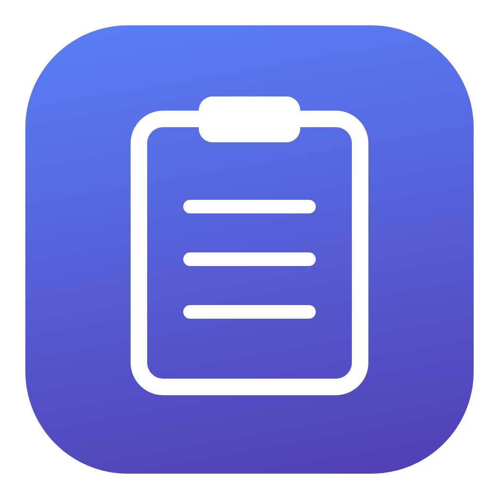

<div align="center">



# Clipboard Assistant

**A little memory for your Mac’s clipboard.**

Keep the things you copy. Find them again. Save what matters.

[](https://github.com/mauringo/clipkeep-macos/actions/workflows/ci.yml)
[](https://github.com/mauringo/homebrew-tap/actions/workflows/cask.yml)
[](https://github.com/mauringo/clipkeep-macos/releases/latest)
[](LICENSE)
[](docs/DISTRIBUTION.md)
[](Package.swift)
[](https://github.com/mauringo/homebrew-tap)

[Install](#install-with-homebrew-recommended) · [Update](#update-from-terminal-recommended) · [Releases](https://github.com/mauringo/clipkeep-macos/releases) · [Suggest a feature](https://github.com/mauringo/clipkeep-macos/issues/new?template=feature_request.yml) · [Report an issue](https://github.com/mauringo/clipkeep-macos/issues)

**Native macOS app · Local storage · Text & images · No account required**

</div>


Clipboard Assistant remembers your copied texts and images, ready to search, preview, copy again, or save to a file. Keep **100 recent entries by default**, choose a limit from **1 to 1,000** plus pinned favorites, and decide whether history survives a restart. It lives in your macOS menu bar and keeps working when you close its window.

## Small app. Useful everyday details.

### Find it. Preview it. Use it.

| Feature | What you can do |
| --- | --- |
| ⌨️ **Your shortcut, your choice** | Record your own global shortcut in Settings. Open history, type to search, use ↑/↓ to select, and press Return to copy and close. |
| 📋 **Clipboard history** | Keep text and PNG/TIFF images, with a configurable limit of 1–1,000 recent entries. |
| 📌 **Pinned favorites** | Keep useful snippets and images at the top, outside the recent-history limit. Pins follow your history-retention setting. |
| 🔎 **Search and filters** | Find copied text or recognized image text; filter the full history by text or images. |
| 👀 **Preview before copying** | Read wrapped text, follow links, and inspect images on the right of the menu-bar dropdown or in the full window. |
| 🧩 **Readable JSON and YAML** | Inspect formatted content and switch to the exact original. Copy and Save preserve the source. |
| 🖼️ **Text from images** | Recognize text on your Mac, search it, select it, and copy it separately from the original image. |

### Save what matters.

| Feature | What you can do |
| --- | --- |
| 💾 **Copy or save in one click** | Use the two icons beside each entry to copy and close, or save the original as UTF-8 text or PNG. Delete one entry with the preview’s trash icon or its row’s right-click menu. |
| 📁 **Titled batch exports** | Select multiple items, or choose **Save all…** for every history entry. Add shared or individual titles, preview filenames, and export into one folder without overwriting existing files. |
| 🖱️ **Drag into your workflow** | Drag original text or images into another app or Finder. |
| ✨ **A native macOS experience** | Toggle the right-hand preview to switch between a compact list and a wider preview. Use familiar macOS controls and closing animations that respect Reduce Motion. |

### Keep control.

| Feature | What you can do |
| --- | --- |
| 🏠 **Local storage** | Keep clipboard history and recognized text on your Mac. No account is required. |
| 🛡️ **Capture exclusions** | Skip selected apps and clipboard content marked confidential or temporary by its source. Unmarked sensitive content still needs care. |
| ⏯️ **Start and stop capture** | Control capture at the top of the preview or in the full app. |
| ⚙️ **Choose what survives a restart** | Save history between sessions or keep it in memory only. Clean history whenever you want. |
| 🚀 **Launch at login** | Start quietly in the menu bar when you sign in. |
| 🍺 **Update from Terminal** | Use Homebrew's prebuilt releases. The optional in-app updater also downloads and verifies a compatible prebuilt app. |

> **What would make your clipboard more useful?**
> [**Suggest a feature →**](https://github.com/mauringo/clipkeep-macos/issues/new?template=feature_request.yml)
> Tell us what you want to copy, find, or save more easily. Small improvements are welcome—we want to keep the app simple and native.

**Your source stays intact.** JSON and YAML formatting only changes the preview. **Copy** and **Save to…** always use the original clipboard text, including whitespace and comments.

## Get started

### Install with Homebrew (recommended)

With [Homebrew](https://brew.sh) installed:

```sh
brew install --cask mauringo/tap/clipboard-assistant
open "/Applications/Clipboard Assistant.app"
```

This uses our [personal Homebrew tap](https://github.com/mauringo/homebrew-tap) and downloads the prebuilt app. No Swift compiler or local build is needed. The current package supports **Apple Silicon Macs running macOS 13 or later**. Homebrew may ask you to trust this third-party cask.

Already installed manually? Quit the app and move the old **Clipboard Assistant.app** bundle to Trash before switching to Homebrew, including any duplicate in **~/Applications**. Keep **~/Library/Application Support/ClipboardAssistant** to preserve saved history. Session-only history is lost when quitting. Then run the install command above.

After installing, turn off **Clipboard Assistant → Automatically Check for Updates** and use the [Terminal update command](#update-from-terminal-recommended). This keeps Homebrew in charge of app versions.

Current downloads are ad hoc signed and are not Apple notarized. macOS may block first launch; Homebrew does not remove that limitation. See [distribution notes](docs/DISTRIBUTION.md).

### Install without Terminal

Download the app archive from [GitHub Releases](https://github.com/mauringo/clipkeep-macos/releases/latest), unzip it, and move **Clipboard Assistant.app** into Applications. The binary archive supports Apple Silicon Macs. Intel users can build from source. Current builds use an ad hoc signature, without Apple notarization; macOS may block downloaded builds. See [distribution notes](docs/DISTRIBUTION.md).


Double-click **Install Clipboard Assistant.app** in `dist`. It contains the complete app, installs it in **~/Applications**, and opens it. No administrator password or developer tools are required to install or run the built app. Updates quit the running copy before replacing it; history follows your existing retention settings.

You can move the installer on its own, or copy **Clipboard Assistant.app** directly into Applications. Open the `.app` bundle in Finder, rather than the executable inside it, to launch without Terminal.

### Build from source

You’ll need **macOS 13 or later**, **Swift 6 or later**, and the **Apple Command Line Tools**. The first build needs internet access to download the YAML dependency.

From the project folder:

```sh
zsh scripts/build-app.sh
open "dist/Clipboard Assistant.app"
```

The build also creates the self-contained Finder installer. The app starts quietly with a **clipboard icon in your menu bar**. Click it for searchable history with a preview on the right; use the expand icon to open the full app window and show its Dock icon. You can drag `dist/Clipboard Assistant.app` into **Applications** to keep it handy.

Already built the app? Just double-click **Clipboard Assistant.app** inside `dist`.

For scripted installation, run `zsh scripts/install-app.sh`. This installs the existing build and opens it; it does not rebuild or download dependencies.

### Your keyboard shortcut

The default shortcut is **⌃⌥V** (Control–Option–V). In **Settings → Keyboard shortcut**, click the recorded combination and press your own shortcut with Command, Option, or Control. Press Escape to cancel recording, use **Reset shortcut** to restore the default, or turn the shortcut off. If macOS reports a conflict, the previous shortcut is kept.

While the menu-bar search field is focused, type to filter, use **↑/↓** to select, and press **Return** to copy the original item and close. Arrow keys in the text preview keep their usual text-selection behavior.

### Compact or expanded preview

Click the **sidebar icon** at the top of the menu-bar dropdown to hide or show its right-hand preview. With the preview hidden, the dropdown shrinks to a compact list. Your choice is remembered between openings and restarts. Search, keyboard selection, Copy, Save, and each row's right-click menu remain available.

### Pin your favorites

Click the **pin** in an item's preview, or right-click its row and choose **Pin**. Pinned items appear first and stay outside the recent-history limit. Unpinning reapplies the limit, so an old item may be removed immediately. Pins survive restarts when **Keep history after restart or reboot** is enabled; session-only mode still clears everything on quit. **Clean history** removes pins too.

### Read text from images

Image previews have an **Image / Text** switch and a **Copy text** button. Apple Vision recognizes text locally in the background, including images already in history. Search matches that recognized text. Copying or saving the image itself still uses the original PNG.

Disable **Settings → Recognize text in images** to stop new recognition; existing recognized text remains stored with its image. If recognition fails, the Text view offers **Try again**.

### Choose what to capture

Open **Settings → Capture & privacy** to exclude an app or change whether confidential and temporary clipboard markers are respected. Marker filtering is enabled by default. Exclusions apply to future copies and use the clipboard's source identifier when supplied, otherwise the app active when the clipboard is checked. This fallback cannot reliably identify every source. Existing history is not removed when an exclusion is added.

Apps must mark their sensitive clipboard data for the marker filter to recognize it; it cannot detect every password or secret. Exclude the source app or stop capture when needed.

### Make yourself at home

1. **Copy something.** Text and clipboard images appear automatically while capture is active.
2. **Find it again.** Search your history or filter by **Text** and **Images**.
3. **Select an entry.** Read wrapped text, open a link, inspect formatted JSON/YAML, or preview an image.
4. **Use it.** Choose **Copy** to put it back on the clipboard, or **Save to…** to export a file.

Drag a row’s **three-line handle** or the **Drag** handle above its preview into another app. Images can also be dragged directly from the preview. Text is offered as the original plain text and a `.txt` file; images are offered as PNG data and a `.png` file. The receiving app chooses what it accepts. For part of a text entry, select text in the preview and drag the selection using macOS’s usual text behavior.


In the full window, click an entry to show its preview. Use its checkbox, **⌘-click**, or **Shift-click** to select several entries; **Select all** selects the entries matching your current search and filter. A regular click returns to one selected entry. Hidden or deleted entries are removed from the selection.

Choose **Save all…** in either window to export all history items, including pins and entries hidden by search or filters. Or choose **Save selected…** in the full window to export only the selection. Enter a shared title (for example, `Project notes`) to create names such as `Project notes-001.txt` and `Project notes-002.png`. You can also enter an individual title for each item and see its filename before saving. Choose **Choose folder & save…**, then select an existing folder or create one. Files are saved directly into that folder in history order; original text and PNG bytes are preserved. Existing files are kept, and matching names receive a numbered suffix. After saving, choose **Show in Finder** to open the folder.

Right-click any entry for copy, save, and delete actions. Use **Clean history…** to remove all entries.

Click the menu-bar clipboard icon to open history with a preview on the right. Search and click an entry to preview its text or image. Each row has two icons on the left: **Copy** puts the original item on the clipboard and closes the dropdown with a short fade and upward motion, without adding another history entry; **Save** exports the original item to a file. Clicking outside the dropdown, pressing Escape, or clicking the menu-bar icon also uses the same closing animation. Reduce Motion uses a fade only. Use **Start/Stop** at the top to control capture, or the expand icon to open the full app for multi-item selection and export. The Dock icon appears while app windows are open and disappears when the last window closes; capture continues in the menu bar. Right-click the clipboard icon for app commands, or use the dropdown’s **…** menu to check for updates or quit.

## Updates

### Update from Terminal (recommended)

For Homebrew installations, quit Clipboard Assistant, then run:

```sh
brew update && brew upgrade --cask mauringo/tap/clipboard-assistant
open "/Applications/Clipboard Assistant.app"
```

Homebrew refreshes the tap and downloads a prebuilt release when a newer version is available. This avoids the local compilation used by the in-app updater. If you have not installed with Homebrew yet, follow the [installation steps](#install-with-homebrew-recommended) once first.

Turn off **Clipboard Assistant → Automatically Check for Updates** to stop background update prompts. We recommend using Homebrew for both installation and updates, rather than mixing it with the app's updater.

Saved history survives an app replacement. Session-only history is lost when quitting. If you use a custom Homebrew app directory, use that directory when reopening the app.

### Other ways to update

- **Finder installer:** download the latest installer archive from [Releases](https://github.com/mauringo/clipkeep-macos/releases/latest), unzip it, and open **Install Clipboard Assistant.app**. This installs into **~/Applications** and reopens the app. It does not compile source.
- **From a source checkout:** run `git pull --ff-only`, then `zsh scripts/build-app.sh` and `zsh scripts/install-app.sh`. This requires Swift 6+ and Apple Command Line Tools and follows the checked-out branch.

### Optional in-app updater

**… → Check for Updates… → Install Update** remains available for manual installations. Starting with **v1.7.0**, it downloads a compatible prebuilt app from the stable GitHub release, verifies its published SHA-256 digest, size, bundle identity, version, and code integrity, then installs and reopens it. No Swift compiler is needed. A release without a compatible verified asset cannot be installed through this route. For Homebrew installations, keep using the Terminal update command.

Automatic checks are **off by default for new installations**; existing preferences are preserved. When enabled, checks run on launch and daily and request release metadata from GitHub; clipboard contents are never included. Protected, renamed, or macOS App Translocation copies install updates into **~/Applications/Clipboard Assistant.app**. Writable copies with the standard name update in place.

Releases remain ad hoc signed, not Developer ID signed or Apple notarized. Checksum and code-integrity verification do not provide Apple publisher verification. Versions through v1.6.2 use the older source-building updater; Homebrew or the Finder installer avoids that build when upgrading to v1.7.0.

### If updating says “Move the app before updating”

Versions through v1.6.0 show this message when the running app cannot be replaced at its current location, including copies that macOS runs from a temporary App Translocation folder. Quit the app, run **Install Clipboard Assistant.app** from the new build or release archive once, and launch **~/Applications/Clipboard Assistant.app**. Saved history is preserved; session-only history is lost when quitting. In v1.6.1 and later, the updater chooses your user Applications folder automatically when the current copy cannot be updated in place.

## History settings

Open **Settings…** from the menu-bar dropdown, the **Clipboard Assistant** application menu, or the **gear** in the full history window. You can also press **⌘,** while an app window is active.

- **Start at login:** use the switch to launch quietly in the menu bar when you sign in to macOS. Install the app in Applications before enabling it. If macOS requires approval, use **Open Login Items Settings…**. The switch reflects macOS registration status; pending approval is shown explicitly.
- **Keep history after restart or reboot:** enabled by default. This switch applies immediately. Turn it off for memory-only history. Switching it off removes the saved archive immediately while keeping current entries available until you quit. The app then starts a new history each time it opens.
- **Maximum entries:** choose any whole number from **1 to 1,000** recent unpinned entries. The default is **100**. Pinned items are kept in addition. Reducing the limit removes the oldest unpinned entries when you click **Apply limit**.
- **Clean history…:** remove all current entries from the app, including saved history, after confirmation. This button is available in both Settings and the main window.

Settings are remembered across restarts even when clipboard history is kept only in memory. Turn on **Start at login** to start capture automatically after signing in.

## Your clipboard, your Mac

When **Keep history after restart or reboot** is enabled, history is stored at:

```text
~/Library/Application Support/ClipboardAssistant/history.json
```

- **Local storage:** clipboard content is never uploaded by the app.
- **Persistent history:** when enabled, text and image data survive restarts, up to your configured limit. With retention off, clipboard entries stay in memory only.
- **Owner-only file permissions:** the archive is restricted to your macOS user, but it is **not encrypted**.
- **Pause when needed:** copied passwords and other sensitive text can be saved like any other text. Pause capture before copying information you don’t want in history.
- **Clear means app history:** clearing history does not erase the system clipboard or files you have already exported.

## A few things to know

- The clipboard is checked every **half second**. Very rapid clipboard changes may be missed.
- The existing clipboard is captured when the app starts. Changes observed while paused are skipped.
- Consecutive identical copies share one history entry. When recent history exceeds your configured limit, the oldest unpinned entry is removed.
- The app captures plain text and PNG/TIFF clipboard images, subject to capture exclusions and clipboard privacy markers. Copying a file in Finder does not import its contents.
- JSON and YAML mappings/lists are formatted automatically. Unrecognized or invalid input remains readable as plain text. YAML comments remain available in **Original** mode.
- The build targets your Mac’s processor architecture and uses a local ad hoc signature. Public distribution without Gatekeeper friction requires Developer ID signing and notarization. Use `zsh scripts/build-app.sh --universal` to build both architectures.

## Development

```sh
swift build
swift test
zsh Tests/UpdaterTests/run.sh
```

| Location | Responsibility |
| --- | --- |
| `Sources/ClipboardAssistant` | SwiftUI interface, AppKit text previews, clipboard capture, menu bar, and file export. |
| `Sources/ClipboardCore` | History settings, configurable limits, optional atomic persistence, and JSON/YAML preview formatting. |
| `Tests/ClipboardCoreTests` | History persistence, eviction, duplicate handling, error recovery, and formatting checks. |
| `scripts/build-app.sh` | Release build, app and Finder installer packaging, dependency license, and local signing. |
| `scripts/install-app.sh` | Install the built app in ~/Applications and launch it. |
| `scripts/installer.applescript` | Finder installer interface, with no Terminal window. |

When building inside a restricted development environment that prevents SwiftPM from starting its subprocess sandbox, use:

```sh
zsh scripts/build-app.sh --disable-sandbox
```

## Acknowledgments

YAML previews use **[Yams](https://github.com/jpsim/Yams)**, an MIT-licensed Swift YAML parser built on LibYAML. Its license is included in the built app’s resources.

## License

Copyright © 2026 Mauro (mauringo).

Released under the **[MIT License](LICENSE)**. You may use, modify, and redistribute the app, including commercially, provided you retain the copyright and license notice in all copies or substantial portions of the software. Third-party license notices must also be preserved.

MIT attribution means retaining the copyright and license text in redistributed copies. You may sell the app or future versions; other recipients may also redistribute or sell MIT versions under those terms. Third-party rights remain with their owners.
