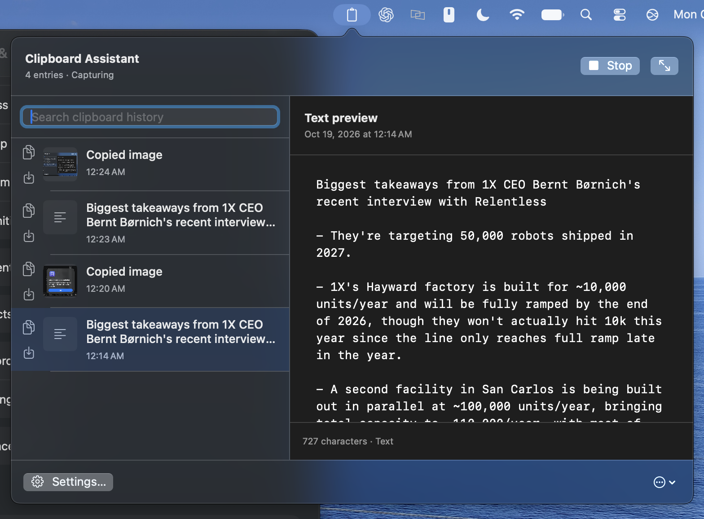
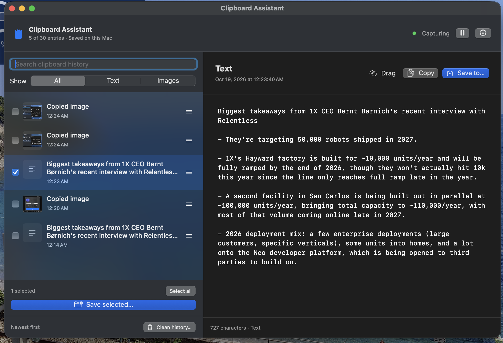

## Menu-bar previews and quick actions

- Start or stop clipboard capture directly at the top of the menu-bar dropdown.
- Click a history entry to select it and preview text or images on the right.
- Use the two icons on the left of each row to copy the original item or save it to a file.
- Copy closes the dropdown with a short fade, scale, and upward motion, without adding a duplicate to history. Reduce Motion uses a fade only.
- Text previews retain selection, clickable links, JSON/YAML formatting, and the Original switch.

## Screenshots

## Install or update

In the app, choose **… → Check for Updates… → Install Update**. The updater downloads this release's source, builds it on your Mac, and replaces and reopens the app. Apple Command Line Tools with Swift 6+ and internet access are required. Saved history is preserved; session-only history is lost when the app restarts.

The downloadable app and Finder installer support Apple Silicon on macOS 13+. They are ad hoc signed and are not Apple notarized. Intel users can build from the tagged source.

Validation: all 30 Swift tests passed with the installed Swift Testing macro plugin loaded explicitly; updater integration checks passed; release app and installer builds and strict code-signature checks passed. Interactive UI verification was unavailable because Computer Use permissions were not granted.
